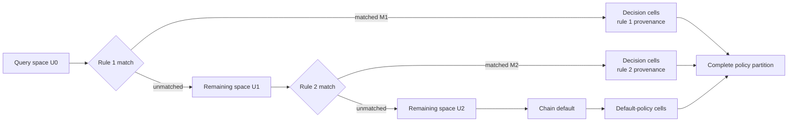

# Semantic Policy Domain

The semantic policy domain is UFWeb's read-only interpretation of normalized UFW rules. It takes the same structural rule semantics used for identity and mutation, combines them with the configured default policies and the finite host/model context needed to interpret `any`, and answers questions about the effective UFW-managed policy over packet space.

This is deliberately different from network reachability. An allowed region means that the modeled UFW user policy permits those packets if they reach that policy. Routing, NAT, connection tracking, service availability, other firewalls, and netfilter rules outside the normalized UFW user-rule surface can still change what happens on the host or network. The [firewall state and rule model](firewall-model.md) remains authoritative for how UFWeb observes and mutates UFW; the policy domain only interprets a supplied snapshot.

## Closed-world policy model

Evaluation operates on one closed policy world for one concrete address family. The caller supplies:

- the normalized rules in authoritative family order;
- the incoming, outgoing, and routed default policies;
- the finite set of known interfaces;
- the supported protocol definitions, including whether source and destination ports apply to each protocol.

IPv4 and IPv6 are separate worlds because UFW evaluates them as separate rule sets. The address universe is the complete selected family, while interfaces and protocols use the finite sets supplied by the caller. A missing rule or query constraint means the complete corresponding domain inside that world; it never means "whatever else may exist on the host."

This closed-world boundary is also the semantic boundary of the evaluator. Connection state, `before.rules`, `after.rules`, NAT, routing, and other state that UFWeb cannot normalize into this model are not inferred or approximated. The UFW active/inactive flag is operational state rather than packet semantics and is therefore not part of a policy world.

Protocol definitions keep protocol membership separate from packet shape. TCP and UDP use numeric source and destination ports. A supported protocol without port semantics instead carries a distinct not-applicable value on those dimensions. A port constraint therefore selects only protocols for which ports exist; an unconstrained query can still cover both port-bearing and portless protocols without inventing combinations such as an ICMP destination port.

The selected traffic chain determines which interface dimensions exist and which default policy resolves unmatched traffic:

| Chain | Interface dimensions | Default policy |
| --- | --- | --- |
| Input | ingress | incoming |
| Output | egress | outgoing |
| Forward | ingress and egress | routed |

For UFW rule projection, inbound `on` maps to ingress, outbound `on` maps to egress, and route rules map their input and output interfaces independently. An interface named by a rule but absent from the supplied interface universe makes that match empty rather than broadening it to `any`.

## Packet space

A policy query constrains any combination of source address, source port, destination address, destination port, protocol, and the interfaces meaningful to its chain. Source and destination constraints are conjunctive: specifying both narrows one packet space rather than invoking a separate pairwise evaluation mode.

### Dimension sets

Each packet dimension is represented as a set relative to the universe supplied by the policy world. Address dimensions use canonical disjoint intervals over the selected IPv4 or IPv6 family, numeric ports use disjoint integer intervals, and protocols and interfaces use finite sets. A missing query or rule constraint means the whole universe for that dimension rather than a special wildcard value.

Port dimensions also preserve protocol applicability. Port-bearing protocols range over the numeric port universe, while protocols without port semantics use the distinct not-applicable value described above. This keeps combinations that do not represent real packets out of the packet space while allowing the same algebra to operate across the complete protocol universe.

### Regions and set algebra

A packet region is the Cartesian product of one set from every dimension meaningful to the selected chain. A packet space is a disjoint union of those regions. Intersection is therefore computed dimension by dimension, while subtraction may split one region into several disjoint regions without enumerating the packets inside it.

For regions $A = A_1 \times \cdots \times A_n$ and $B = B_1 \times \cdots \times B_n$, the difference can be decomposed along the dimensions as:

$$
A \setminus B = \bigsqcup_{i=1}^{n}
\left(
    \prod_{j < i}(A_j \cap B_j)
    \times (A_i \setminus B_i)
    \times \prod_{j > i} A_j
\right)
$$

Empty pieces are discarded. The remaining pieces are disjoint and cover exactly the part of $A$ outside $B$. Compatible regions can then be coalesced again; when they are policy cells, their decision and provenance must agree as well. This is what lets an earlier rule shadow only one source subnet, port interval, protocol subset, or combination of dimensions while the unaffected remainder continues through later rules.

This representation is independent of firewall actions. Adding another interface or supported protocol changes the closed-world data supplied to evaluation, not the first-match algorithm. Adding a protocol with different port applicability changes its protocol definition rather than requiring a separate evaluator.

## Ordered policy evaluation

Policy evaluation applies one chain of the selected family in authoritative order. At every step only the still-undecided packet space is considered. If rule $i$ matches region $R_i$ and $U_i$ is the space still undecided before that rule, then:

$$
M_i = U_i \cap R_i
$$

is classified by the rule, and

$$
U_{i+1} = U_i \setminus R_i
$$

continues to later rules. This is ordinary UFW first-match behavior lifted from individual packets to sets. It naturally handles partial shadowing: an earlier rule can decide only part of a later rule's match while the remainder continues through the chain. After the final user rule, the chain's configured default policy classifies the remaining space.

Rules belonging to other chains are skipped without changing the relative order of the rules that do participate. `Allow`, `Deny`, and `Reject` are terminal decisions. `Limit` remains a distinct terminal classification because the runtime rate state needed to resolve it further is outside the model.

## Policy partitions and provenance

Evaluation returns a complete partition of the queried space. Every packet represented by the query belongs to exactly one result region, result regions do not overlap, and each region carries both its effective decision and the provenance that made that decision final.

Rule provenance contains semantic rule identity plus its occurrence in the family order. This keeps evidence tied to the actual first-match occurrence even when equivalent rules are present. Traffic not claimed by a user rule records the relevant chain default as its provenance. Regions with different provenance remain distinct even when they carry the same decision, so an explanation does not lose the rule responsible for a result.

The partition is intended as the stable input to higher-level analysis. Consumers can narrow an already evaluated result, project dimensions such as source or destination networks, group regions by effective decision or provenance, and compare decision spaces without reimplementing rule semantics. Packet spaces from separately constructed worlds can participate in set comparison when their packet universes are equivalent. That comparison answers whether two decision sets contain the same packets, and it intentionally ignores which rule produced them. Where the decisions or the responsible rules diverge is a diff of the two partitions, described below.

## Comparing policy worlds

Two closed worlds are comparable under one shared query only when their packet universes are equivalent: the same address family and address universe, the same protocol definitions (including whether each protocol uses ports), and the same interface universe. A mismatch is rejected. The comparison does not silently intersect the universes, because unconstrained rules and `any` would then mean different packet sets on each side and the result would no longer be exact.

Each world is evaluated on its own with the first-match algorithm above. The diff is the overlay of those two partitions, not a third walk of the rules. For partitions $B$ and $C$ of the same query $Q$,

$$
Q = \bigsqcup_{b \in B,\, c \in C} (b \cap c)
$$

Empty intersections are discarded. Pieces that carry the same pair of decisions and the same pair of full provenances are coalesced with the same one-axis factoring used for policy cells. The result is exact: it contains every queried packet, it contains no packet outside the query, and its regions do not overlap. An empty query produces an empty diff. That is a different statement from "the worlds agree." Agreement is a cover of the query by regions in which nothing differs.

Every region carries the effective decision and the full provenance from both worlds. Provenance still includes rule identity plus that world's family order, or the chain default, so a caller can trace the occurrence that fired on each side. The region is also classified by two independent questions:

|  | Same semantic responsibility | Different semantic responsibility |
| --- | --- | --- |
| Same decision | unchanged | responsibility shift |
| Different decision | decision change | both |

A decision change is an observable policy difference. `Allow`, `Deny`, `Reject`, and `Limit` are different outcomes, and `Limit` is not collapsed into allow or deny. A responsibility shift is a change in which semantic rule, or which chain default, accounts for the packet. Either axis can change alone, and they overlap where both change. Callers can read the four kinds as the partition, or retrieve either axis on its own. The decision-change set is the union of "decision change" and "both". The responsibility-shift set is the union of "responsibility shift" and "both". Those two sets may overlap. The packets where at least one axis differs, and the packets where neither differs, are complements: they do not overlap, and their union is the query.

Semantic responsibility is not family order. Family order is the index of a rule in that world's ordered list, and every chain shares the list. Inserting or removing a rule renumbers every later row, including rules on other chains. A rule is the same responsibility in both worlds when its rule identity is equal, whatever index it occupies in each list. The chain default is the same responsibility when it is the default of the same chain; the default action belongs to the decision, not to the responsibility. A rule and a default are never the same responsibility. Positional provenance equality remains available on the values carried in the region, for callers that need the occurrence index inside one world. It is not the diff's responsibility test.

`RuleId` is an opaque semantic identity, not a stable logical entity ID for edits. The firewall projection supplies its canonical identity from the normalized rule semantics, including action, while excluding comments and UFW numbering. Callers constructing worlds directly must use the same identity for equivalent rules and distinct identities for different rule semantics. The diff does not infer identity from coincidentally equivalent effective matches when IDs differ. To prevent misleading comparisons, reused IDs are checked across and within the input worlds: they must refer to the same chain, decision, and resolved match, even outside the selected query. This validates the implication from equal IDs to equal represented semantics; canonical ID assignment remains the caller's responsibility.

Repeated occurrences of the same semantic rule are legal. Their occurrence-specific provenance remains distinct inside a world, while responsibility correspondence across worlds ignores their positions. A rule that changes its action or match semantics needs a different identity. When a default action changes, the decision changes but the responsible default stays the same.

The diff stays consistent with the two evaluations it came from. The decision and provenance on each side of a region are the decision and provenance that world's own partition assigns to those packets.

## Counterfactual rule removal

The first analysis built on the diff asks what changes if one rule occurrence is removed. The analyzer builds a candidate world that is the original world without that occurrence, then compares the original, as the baseline, with the candidate under the caller's query. Baseline values are the policy before removal. Candidate values are the policy after removal. The original world is not modified: its rule objects, family orders, and list stay in place.

The occurrence is the rule instance in that world, not the rule identity by itself, so one of several rules that share an identity can be removed. A rule object from another world is rejected. The candidate keeps the same universes and defaults. The remaining rules keep their relative order and are resolved again, so their family orders are contiguous from zero. Resolution is the same path used to build a world, rather than a reconstruction that guesses which axes were originally unconstrained.

The query selects the chain under analysis. Removing a rule on a chain that query does not evaluate leaves the query unchanged; that is an exact answer, not an error. Packets the removed occurrence never decided keep their decision and their semantic responsibility. Later rules may still show a new family order in the carried provenance, and that renumbering is not a responsibility shift. Packets it did decide move to the next matching rule on that chain, or to the chain default. The diff reports the decision change, the responsibility shift, or both, that this hand-off actually produces.

A later occurrence of the same semantic rule that takes over is not a responsibility shift, provided it has the same action and match as required by the identity contract. Removing an occurrence can therefore produce no effective change despite replacing the deciding occurrence. After renumbering, the survivor can also occupy the same family-order index as the removed occurrence, so positional provenance alone cannot establish occurrence continuity. The counterfactual caller already holds the removed occurrence; semantic comparison does not promote list position to cross-world identity.

Removal is still a question about the modeled policy, not about reachability. It does not simulate connection tracking, NAT, or rules outside the world. Further hypothetical edits, such as replacement or a new default, are further candidates compared with the same diff. They do not need another evaluator.

## Projection from firewall state

`Ufw.Shared.Domain` does not read UFW, query a database, or discover interfaces. The firewall projection boundary adapts already normalized `Ufw.Shared.Firewall` state into the closed-world model. Other callers can construct the same domain model directly without depending on daemon or browser types.

Projection preserves the authoritative rule order and family semantics. A supported listed rule is normalized and checked against its semantic identity before becoming a domain rule. An opaque row in the family being projected fails the projection because its match cannot be represented safely; silently skipping it would allow later rules or the default policy to claim traffic whose first match is unknown. An opaque row that is known to belong only to the other family does not affect the selected world.

IPv6 projection from an authoritative snapshot also requires IPv6 to be enabled, because disabled IPv6 rules are not part of UFW's active observable rule set. Projection from a hypothetical ordered specification list does not apply that host capability check because it is not describing a current host snapshot.

Comments, display numbers, application metadata, and presentation state do not participate in packet matching. Known interface names matter only because they define the finite interface universe used by `any` and by explicit interface constraints.

## Extension boundary

The generic set algebra and first-match evaluator do not encode specific policy-exploration questions. Source-centric, destination-centric, pairwise, and shadowing questions are consumers of one partition. A world diff is the overlay of two such partitions, and counterfactual removal is a consumer of that diff rather than another policy engine. Comparing two rule orderings is the same diff applied to two worlds that share a packet universe.

Extending an existing finite dimension is correspondingly local: a newly known interface expands the interface universe; a newly supported protocol adds a protocol definition; a new terminal action adds another decision label that the evaluator carries through. A genuinely new packet dimension requires the firewall packet layout to expose that dimension, but intersection, subtraction, and ordered evaluation remain unchanged.

Features such as connection-state reasoning, NAT, or arbitrary netfilter chains cross a different boundary. They require both a new semantic dimension or transformation and an authoritative source from which UFWeb can populate it; they cannot be made correct merely by widening one of the existing closed-world sets. The [filter system state](system-state.md) is that kind of source for the active filter table: chain structure and opaque matches, not a packet-space evaluation.
