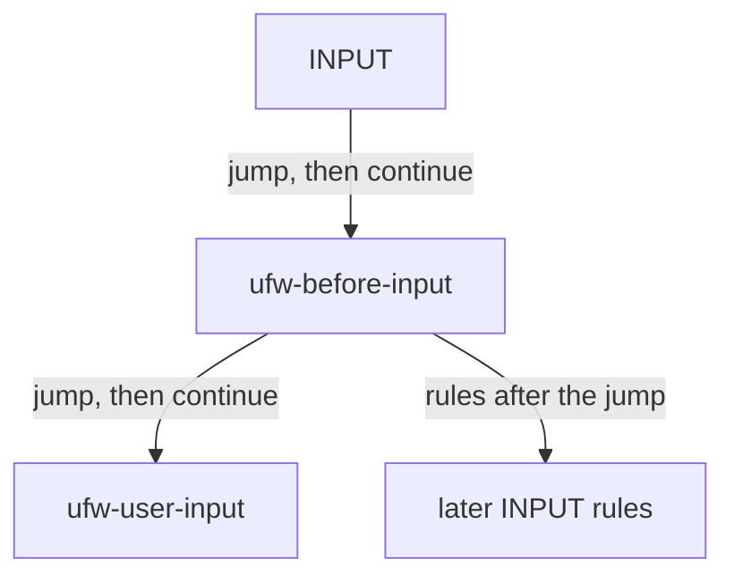

# Filter system state

This document defines the read-only structural view of the host's active filter table. It sits beside the [firewall state and rule model](firewall-model.md), which remains the contract for observing and mutating UFW user rules, and beside the [semantic policy domain](domain.md), which interprets an already normalized user-rule list. The filter view does not replace either of them, and it does not evaluate packets.

UFW's numbered status is a projection of the user-rule files. The kernel filter table also contains the chains UFW builds around those rules, plus whatever else the host has installed. `iptables-save` and `ip6tables-save` are the authoritative observation of that table. `user.rules` and `user6.rules` are used only to recognize which live rules came from a UFW user rule.

## What is observed

The daemon reads both save commands for the filter table, under the same execution gate as other firewall reads, and with a deterministic locale. A non-zero exit, a command that cannot be started, or output that is not a filter save fails the read. The two families are one observation: IPv6 is not omitted because UFW's `IPV6` setting is disabled, and a failure of either command fails the whole read.

Save output may contain other tables. They are skipped. The model keeps the filter table only: each chain, its policy, and its rules in order. Built-in chains carry `ACCEPT` or `DROP`. User chains have no policy. Packet and byte counters are accepted in the text and are not part of the model.

`GET /api/v1/system-state` returns this snapshot. It is not signed, it does not mutate the firewall, and it does not change `GET /api/v1/rules`. ASP and the browser do not call it yet.

The inventory can be explicitly disabled for development hosts without iptables tooling; a disabled inventory returns `501 Not Implemented` without starting firewall observation. When enabled, the save binaries and two user-rule paths are explicit required daemon settings, alongside the UFW executable. An unavailable or invalid user-rule file suppresses enrichment for its family, with a diagnostic in the returned state, rather than failing the authoritative physical inventory. The daemon validates that both save executables exist at startup when inventory is enabled; execution or parse failures are still reported by the inventory read.

## Raw rules

A raw rule keeps the chain that owns it and its zero-based index in that chain. That location is the rule's physical identity for the snapshot. Two identical lines are two rules. The order of clauses on a rule is the order in the save text. The original active save declaration is also retained verbatim, so unsupported options and their original spelling/quoting remain available even when a clause cannot be interpreted.

Clauses that correspond to UFW's filter predicates are structured, and negation is part of the clause:

| Clause | iptables form |
| --- | --- |
| Source or destination address | `-s` / `-d` and the long names, with an optional prefix or dotted IPv4 mask |
| Protocol | `-p` / `--protocol` |
| Source or destination port | `--sport`, `--dport`, and the multiport list forms |
| Either port | multiport `--ports` |
| Ingress or egress interface | `-i` / `-o`, including a trailing `+` |

Addresses use the same canonical form as a UFW rule specification: a zero prefix is no address constraint, and a CIDR is stored on its network boundary. An explicit `all` or numeric `0` protocol is the same as omitting `-p`. Everything else is stored and not interpreted. That includes conntrack, recent, limit, comment, tcp flags, ICMP type, fragments, and target options such as `--reject-with` or `--log-prefix`. Known module-specific port predicates are interpreted only in their applicable protocol/match context; identically named options following an unknown `-m` module remain opaque. Core protocol/address/interface options can still be represented independently. An unknown module and its options stay together as an opaque clause, with normalized whitespace, without assuming extension-specific semantics.

The target records whether the rule used `-j` or `-g`, the target name, and any uninterpreted target arguments. After a target declaration, subsequent options are treated as target arguments rather than accidentally promoted into ordinary predicates. A name is a chain reference only when that chain exists in the same table. `ACCEPT`, `DROP`, `RETURN`, and extension targets are not references unless a chain was actually declared with that name.

## Resolved roots

The raw table resolves to three roots, `INPUT`, `OUTPUT`, and `FORWARD`. The raw chain graph is always the complete authoritative inventory. Root expansion is a bounded presentation view, not an additional source of physical rules. Walking a root lists its rules in structural order. When a rule's target is a chain reference, the target chain's rules are inlined at that point, and the walk then continues with the later rules of the caller. Jump and goto are both references; the target kind stays on the rule, and later rules of the caller are still listed. `ACCEPT`, `DROP`, `REJECT`, and `RETURN` do not prune the walk. This is the shape of the chain graph, not a prediction of which rule a packet would hit.

Each emitted rule keeps the physical location above. Provenance is the chain that owned the rule in the save output. Both the chain-name path and the ordered physical jump occurrences used to reach it are recorded; these distinguish separate jumps to the same chain. A chain reached by two different jumps is inlined twice, with both emitted occurrences sharing one physical location. A chain already on the active walk stack is not entered again.

To avoid exponential expansion of small chain graphs, each root is limited to 20,000 emitted entries and a maximum chain depth of 128. The root's `TraversalStatus` identifies a rule-count limit, depth limit, or cycle. A bounded expansion is incomplete and must never be mistaken for the full graph; consumers can always inspect the complete raw table. Managed-rule associations are also available by physical location independently of the bounded per-root expansion. A built-in chain that is absent from the table is an empty root with no policy. Chains that nothing reaches from the three roots remain in the raw table only.

## User-rule enrichment

Inside `### RULES ###`, UFW writes a `### tuple ###` line and then the iptables lines that install that one user rule. Limit, logging, and a port-constrained `any` protocol are the usual reasons one tuple becomes several lines. Lines that are not under a tuple — the limit-chain boilerplate and the logging sections — are not user-rule translations.

A dedicated compositional grammar parses UFW tuples into typed syntax nodes for actions, protocols, source/destination endpoints, application metadata, interface directions, and comments. Supported layouts have six base fields, optionally followed by a direction, an application pair, or both, plus an optional hex-encoded `comment=`. The interpreter maps that validated syntax to the mutable rule model only when representable. Only translations within the `filter` table become attribution evidence. `route:` marks a forward rule. A `_log` or `_log-all` suffix is not a separate action in the mutable rule model, so the reference uses the underlying allow, deny, reject, or limit. When the tuple fits that model, the reference carries the normalized specification and the same `RuleId` the rule list would compute. A protocol the mutable model cannot name, such as `esp`, can still be parsed structurally in the raw inventory, but cannot establish managed identity through the current numbered-rule model.

Managed identity is not established by `user.rules` alone. The daemon independently observes `ufw status numbered` (including the verbose/defaults consistency checks in the existing snapshot reader). File tuples are grouped with observed managed occurrences by semantic rule identity (which includes address family and direction); stable ordering distinguishes identical occurrences within each identity. Mismatched multiplicities leave that identity unattributed, without blocking unrelated matches. Successful links retain the actual observed specification and identity; if the views disagree, contain opaque numbered rows, or the UFW observation fails, managed enrichment is withheld without removing any physical iptables rules. This cross-source comparison is intentionally not atomic.

Reconciliation uses order-preserving alignment of configured translations with observed physical rules. Structured clauses compare as multisets, so harmless predicate reordering and an implicit `-m tcp` around a port still match. Opaque clauses carry parser-produced token sequences and require exact token equivalence apart from recognized save-time defaults of the `recent` module, and target options require equivalence apart from an implicit default `REJECT` argument. Unrecognized extra predicates are not ignored. An installed physical rule is associated with a source occurrence only when its ordered correspondence is unambiguous; if one of multiple otherwise identical configured occurrences is missing, all ambiguous associations remain absent. A bounded alignment budget prevents oversized source inputs from affecting the completeness of the authoritative physical inventory.

The live rule is kept whether or not a tuple matches. A tuple whose lines are not in the live table adds no rules. Enrichment never filters the snapshot. Out-of-band edits to UFW-managed chains are not a supported configuration; the matcher does not try to repair them.

Managed attribution is optional. Each address family reports an `Enrichment` status: `Complete` means all usable configured translations were associated, `Partial` means some correspondence is unresolved, `Unavailable` means an optional source or numbered status could not be read, and `ResourceLimitReached` means the attribution alignment exceeded its work budget. An optional diagnostic explains degraded states. A missing, unreadable, or malformed user-rule file does not invalidate a successful active iptables observation; only that family's enrichment becomes unavailable. A failed numbered UFW snapshot withholds attribution for both families. This report distinguishes an unattributed physical rule from incomplete or unavailable enrichment.

## What this model is not

It does not decide allow or deny, and it does not feed the semantic policy evaluator. Connection tracking, NAT, routing, and the `before.rules` / `after.rules` behavior are visible here only as structure and opaque text. Turning a region of that structure into a packet-space question is later work, and it has to say which opaque clauses it understands instead of treating the flattened list as if it were already a UFW user chain.
